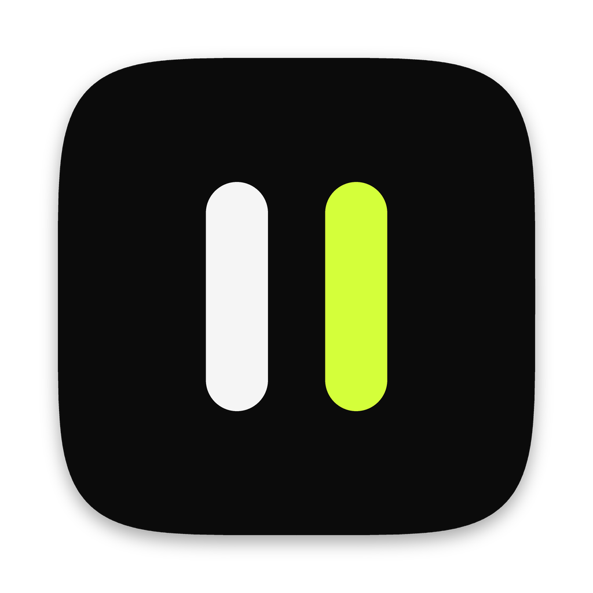
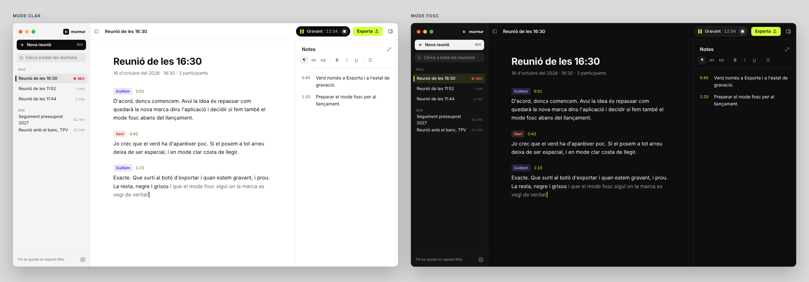

<p align="center">
  
</p>

<h1 align="center">Murmur</h1>

<p align="center">
  Transcripció de reunions que no surt mai del teu ordinador.<br />
  En català, castellà i anglès, en directe i amb qui diu què.
</p>

<p align="center">
  <a href="https://github.com/quicodomingo/murmur-releases/releases/latest">Descarrega-la per a macOS, Windows i Linux</a> ·
  <a href="README.md">English</a> ·
  <a href="README.es.md">Español</a>
</p>



Murmur és una app per a macOS, Windows i Linux que transcriu les reunions mentre passen. Tot funciona a l'ordinador, i cap àudio va a cap servidor. També distingeix qui parla i et deixa prendre notes i captures de pantalla lligades al moment en què les fas. En acabar, pot escriure un resum amb el to, les decisions i les tasques. El pots compartir amb un enllaç o desar-lo en Markdown a la teva carpeta.

Va néixer per a reunions en **català**, on la majoria de serveis de transcripció fallen. Sobretot quan la gent passa del català al castellà dins de la mateixa frase.

## Què fa

- **Transcripció en directe** en català, en castellà, en català i castellà barrejats o en anglès. En començar tries l'idioma i si hi ha més gent a la sala, i més endavant pots tornar a transcriure una reunió en un altre idioma.
- **El micròfon i la trucada, per separat.** Murmur grava el micròfon i l'àudio del sistema (Zoom, Meet, Teams…) en dos canals i n'elimina l'eco. Per això funciona també amb altaveus, no només amb auriculars. Mai no grava la pantalla: només en fa una captura quan tu la demanes. L'àudio del sistema funciona a macOS i a Windows; a Linux, de moment, Murmur grava només el micròfon.
- **Parlants.** Les veus s'agrupen en directe. En acabar, una segona passada per tota la gravació comprova qui ha dit cada cosa. Pots canviar «Parlant 1» pel nom real o triar-lo entre els convidats de l'esdeveniment del calendari, i si una mateixa persona surt com a dos parlants, els ajuntes amb un clic.
- **Passada final amb Whisper.** Quan la reunió és en una sola llengua, Whisper large-v3-turbo la torna a escoltar quan atures la gravació. Reescriu el text amb puntuació, majúscules i noms propis. No toca les frases que hagis corregit a mà.
- **Puntuació de Softcatalà.** Quan la reunió barreja català i castellà, o no tens Whisper, el model de puntuació de Softcatalà hi posa punts, comes i majúscules en acabar. És opcional (126 MB) i es descarrega des de Configuració › Transcripció.
- **Continuar una reunió.** Si atures massa d'hora o feu una pausa, «Continua» torna a gravar dins la mateixa reunió. La pausa queda marcada a la transcripció, les veus de la primera part tornen amb el seu nom i el resum es fa amb tota la reunió.
- **Glossari.** Afegeix-hi els noms, les marques i les sigles que la transcripció escriu malament (WordPress, Softcatalà, el nom d'un client) i Murmur els escriurà bé, en directe i en acabar. Quan corregeixes un nom a mà, et proposa afegir-lo. En una reunió del calendari hi compten també els noms dels convidats, i el resum els escriu igual.
- **Barra flotant mentre graves.** Una píndola petita a la vora de la pantalla queda al davant de la trucada. Mostra el nivell de l'àudio, torna a obrir Murmur, atura la gravació i fa captures de la pantalla compartida. Cada captura queda lligada al moment de la conversa: surt al costat del que s'estava dient i dins la part corresponent del resum. Si cliques la píndola, Murmur es converteix en una finestra estreta de notes al costat de la trucada.
- **Transcriure des d'un fitxer.** Fitxer › Transcriu des d'un fitxer… (⌘O, o Ctrl+O a Windows i Linux) converteix un mp3, m4a, wav, ogg o qualsevol altre àudio en una reunió, amb els parlants i la passada final. Murmur endevina sol en quin idioma és. També hi pots enviar un àudio des del menú Compartir d'altres apps, amb «Obre amb» (al Finder, a l'Explorador o al teu gestor de fitxers) o deixant-lo anar a la finestra o a la icona del Dock.
- **Connector per a Claude**, opcional. Claude Desktop i Claude Code poden llegir i cercar les teves reunions i transcriure àudios amb Murmur, al teu ordinador. S'activa a Configuració › Claude.
- **Notes** amb títols, llistes, caselles i sagnats amb Tab. Cada bloc recorda el minut en què es va escriure i surt al costat de la transcripció. Amb ⌘+ i ⌘− (Ctrl+ i Ctrl− a Windows i Linux) fas més gran o més petit el text de les notes.
- **Resum de la reunió**, opcional. Té títol, resum, to, decisions i tasques, i l'escriu un model de llenguatge local (Gemma 4 E4B). Les tasques es poden marcar, editar i assignar. Si ho prefereixes, el pot escriure Claude o OpenAI amb la teva clau: només s'hi envia el text, mai l'àudio.
- **Etiquetes** per ordenar les reunions. Les pots filtrar a la barra lateral i cercar-les, i amb el clic dret les reanomenes, les ajuntes o les esborres.
- **Calendari.** Murmur t'avisa dos minuts abans que comenci una reunió, i la gravació agafa el títol i els convidats de l'esdeveniment. Funciona amb qualsevol calendari afegit a macOS: iCloud, Google o Exchange. De moment, només a macOS.
- **Compartir amb un enllaç.** Tries què hi surt (resum, notes, transcripció, captures, àudio), quan caduca l'enllaç i si porta contrasenya. Murmur ho xifra a l'ordinador i ho publica al teu compte de Cloudflare, que és gratuït i es configura des de l'app.
- **Markdown a la teva carpeta.** Tria una carpeta i Murmur hi desa cada reunió quan acaba: tot (el resum amb les notes i la transcripció, en dos fitxers), només el resum i les notes o només la transcripció. Mentre graves, ho pots activar o desactivar per a aquella reunió.
- **Cerca** a totes les reunions, i exportació a Markdown, Word, PDF, àudio (.m4a a macOS, .ogg a Windows i Linux) i captures. Al Word i al Markdown tries si hi va tot, el resum o la transcripció.
- **Interfície** en català, castellà i anglès, amb tres temes de color i mode clar i fosc.
- **macOS, Windows i Linux.** La mateixa app als tres sistemes, i s'actualitza sola a tots. De moment hi ha coses que només són al Mac: el calendari, les captures de pantalla, l'avís quan comença una trucada i el menú Compartir.

## Privadesa

- Tot es fa a l'ordinador: el reconeixement de veu, els parlants, Whisper i el model del resum. Escriure el resum amb Claude o OpenAI és opcional, fa servir la teva clau (desada al clauer del sistema: el de macOS, el Gestor de credencials de Windows o el Secret Service de Linux) i només hi envia text.
- Murmur només es connecta a internet per descarregar models (el primer cop, i quan actives una funció opcional) i per buscar actualitzacions. Aquesta comprovació es pot desactivar. Les reunions compartides es xifren a l'ordinador abans de sortir-ne, i només les pot llegir qui té l'enllaç. Amb el connector per a Claude activat, Claude rep el text que demana, mai l'àudio.
- Les reunions es desen en una base de dades SQLite local. L'àudio només es desa si ho actives.
- Per gravar una reunió cal el consentiment de tothom que hi participa. Murmur t'ho recorda en començar.

## Requisits

- **macOS:** un Mac amb Apple Silicon (M1 o posterior) i macOS 14.2 o posterior.
- **Windows:** Windows 10 o 11 de 64 bits (x86-64), amb un processador amb AVX2 (Intel des del 2013, AMD des del 2015). WebView2 ja ve amb Windows, i si no hi és l'instal·lador l'afegeix.
- **Linux:** una distribució de 64 bits (x86-64) amb WebKitGTK 4.1, com Ubuntu 22.04 o posterior, Debian 12 o Fedora 38 o posterior, amb un processador amb AVX2. Per desar les claus, un Secret Service (GNOME Keyring o KWallet).
- 8 GB de memòria. Per al resum local se'n recomanen 16. A Windows i Linux tot va pel processador, i la passada final i el resum són més lents que en un Mac.
- Uns 600 MB de disc per als models bàsics. Els opcionals n'ocupen més: anglès, 458 MB; Whisper, 574 MB; Gemma, 5,2 GB.

## Instal·lació

Tot és a [Releases](https://github.com/quicodomingo/murmur-releases/releases/latest). El primer cop que l'obres, Murmur descarrega els models de veu (uns 600 MB). S'actualitza sola als tres sistemes.

**macOS.** Descarrega el `.dmg` i arrossega Murmur a Aplicacions. L'app està signada i notaritzada per Apple. Et demana aquests permisos:

- **Micròfon.**
- **Gravació d'àudio del sistema**, per sentir l'altra banda de la trucada.
- **Calendari**, opcional.
- **Gravació de pantalla**, només si vols fer captures d'una pantalla compartida.

**Windows.** Descarrega `Murmur_<versió>_x64-setup.exe` i executa'l. S'instal·la només per al teu usuari, sense permisos d'administrador. L'instal·lador encara no està signat amb un certificat de Windows, i és possible que SmartScreen t'avisi el primer cop: fes clic a *Més informació › Executa igualment*. Si Windows no deixa que Murmur faci servir el micròfon, activa-ho a Configuració › Privadesa i seguretat › Micròfon.

**Linux.** Tria el paquet de la teva distribució:

```bash
# Debian, Ubuntu i derivades
sudo apt install ./Murmur_<versió>_amd64.deb

# Fedora, openSUSE i derivades
sudo dnf install ./Murmur-<versió>-1.x86_64.rpm

# Qualsevol distribució: l'AppImage, que també s'actualitza sola
chmod +x Murmur_<versió>_amd64.AppImage && ./Murmur_<versió>_amd64.AppImage
```

Els paquets `.deb` i `.rpm` no s'actualitzen sols: instal·la la versió nova de la mateixa manera. L'AppImage, sí.

## Models

| Què | Model | De | Llicència |
|---|---|---|---|
| Català i castellà, en directe | Conformer-Transducer ca-es | Projecte AINA (BSC), a partir d'NVIDIA | CC BY 4.0 |
| Anglès, en directe | Parakeet TDT-CTC 110M | NVIDIA | CC BY 4.0 |
| Passada final | Whisper large-v3-turbo (whisper.cpp) | OpenAI | MIT |
| Puntuació en català | fullstop-catalan-punctuation-prediction | Softcatalà | MIT |
| Detecció de veu | Silero VAD | Silero | MIT |
| Parlants, en directe | TitaNet small | NVIDIA NeMo | Apache 2.0 |
| Parlants, passada final | pyannote segmentation 3.0 + ERes2Net | pyannote, 3D-Speaker | MIT, Apache 2.0 |
| Resum | Gemma 4 E4B | Google | Apache 2.0 |

La veu i els parlants funcionen amb [sherpa-onnx](https://github.com/k2-fsa/sherpa-onnx). Whisper funciona amb [whisper.cpp](https://github.com/ggml-org/whisper.cpp), i Gemma amb [llama.cpp](https://github.com/ggml-org/llama.cpp). Tots dos fan servir Metal al Mac, i el processador (AVX2) a Windows i Linux.

## Compilar-la

Necessites [Rust](https://rustup.rs), Node.js 20 o posterior i CMake, i en cada sistema:

- **macOS:** les Command Line Tools de Xcode i CMake (`brew install cmake`).
- **Windows:** les [Build Tools de Visual Studio](https://visualstudio.microsoft.com/visual-cpp-build-tools/) amb *Desenvolupament per a l'escriptori amb C++*, [CMake](https://cmake.org/download/) i [LLVM](https://github.com/llvm/llvm-project/releases) (per a `libclang`).
- **Linux** (Debian o Ubuntu):
  ```bash
  sudo apt install build-essential cmake clang libwebkit2gtk-4.1-dev libayatana-appindicator3-dev \
    librsvg2-dev patchelf libasound2-dev libdbus-1-dev libssl-dev
  ```

Després, en qualsevol d'ells:

```bash
git clone https://github.com/quicodomingo/murmur.git
cd murmur/app
npm install
npm run tauri dev
```

`tauri dev` també compila `murmur-whisper`, el procés a part que fa córrer Whisper. Els models es descarreguen el primer cop que obres l'app, a `models/`, a l'arrel del repositori.

Altres ordres útils:

```bash
# L'app amb un WAV (16 kHz) en lloc del micròfon, al ritme real
TRANSCRIPTOR_SIMULATE=../data/reunio.wav npm run tauri dev

# El motor en directe sense interfície
cd src-tauri && cargo run --release --example simulate -- ../../data/reunio.wav

# Tests i comprovacions
cd src-tauri && cargo test
cd app && npx tsc --noEmit && npm run check-locales

# Proves e2e de l'app compilada (vegeu app/e2e/wdio.conf.mjs)
cd app && npm run tauri build -- --debug --no-bundle
cd e2e && npm ci && npm run motor        # el motor transcriu un fitxer de veritat (qualsevol sistema)
npm run interficie && npm run importa    # la interfície, amb tauri-driver (Windows i Linux)
```

`npm run tauri build` fa els instal·ladors del sistema on ets: una `.app` a macOS, un instal·lador `.exe` a Windows, i `.deb`, `.rpm` i AppImage a Linux. GitHub Actions compila i prova cada canvi als tres sistemes ([`.github/workflows/ci.yml`](.github/workflows/ci.yml)), i en pujar una etiqueta `v<versió>` publica la versió ([`release.yml`](.github/workflows/release.yml)). La versió per a Mac està signada i notaritzada, i cal un Developer ID d'Apple. Ho explica [docs/PUBLICAR.md](docs/PUBLICAR.md).

## Estructura del repositori

| Carpeta | Què hi ha |
|---|---|
| `app/` | L'app: interfície en React (`src/`), motor en Rust (`src-tauri/`) i procés de Whisper (`whisper/`) |
| `bench/` | Banc de proves en Python per triar els models (WER, factor de temps real, encerts de parlants) |
| `mvp/` | El primer prototip, en Python amb interfície web. Es manté com a referència |
| `tools/` | Scripts per exportar els models de NeMo a ONNX |
| `docs/` | Full de ruta, sistema de disseny, traduccions i guia per publicar |

[docs/ARQUITECTURA.md](docs/ARQUITECTURA.md) explica com funciona per dins i què s'ha mesurat per decidir-ho, i [CLAUDE.md](CLAUDE.md) té les regles per treballar en el codi (per a persones i agents de codi).

## Traduccions

La interfície està en català, castellà i anglès. Els textos són a `app/src/locales/<idioma>/`. Per corregir una traducció o afegir un idioma, mira [docs/TRADUCCIONS.md](docs/TRADUCCIONS.md).

## Full de ruta

Els propers passos són el calendari i les captures a Windows i Linux, l'àudio del sistema a Linux i millorar la detecció de parlants. La llista completa és a [docs/ROADMAP.md](docs/ROADMAP.md).

## Col·laborar

Els *issues* i les *pull requests* són benvinguts. Ens són especialment útils les gravacions de reunions reals amb una transcripció feta a mà, perquè serveixen per mesurar la precisió. Comparteix-les només si tothom qui hi surt hi està d'acord.

## Llicència

[MIT](LICENSE). Els models mantenen les seves pròpies llicències (vegeu [Models](#models)).
