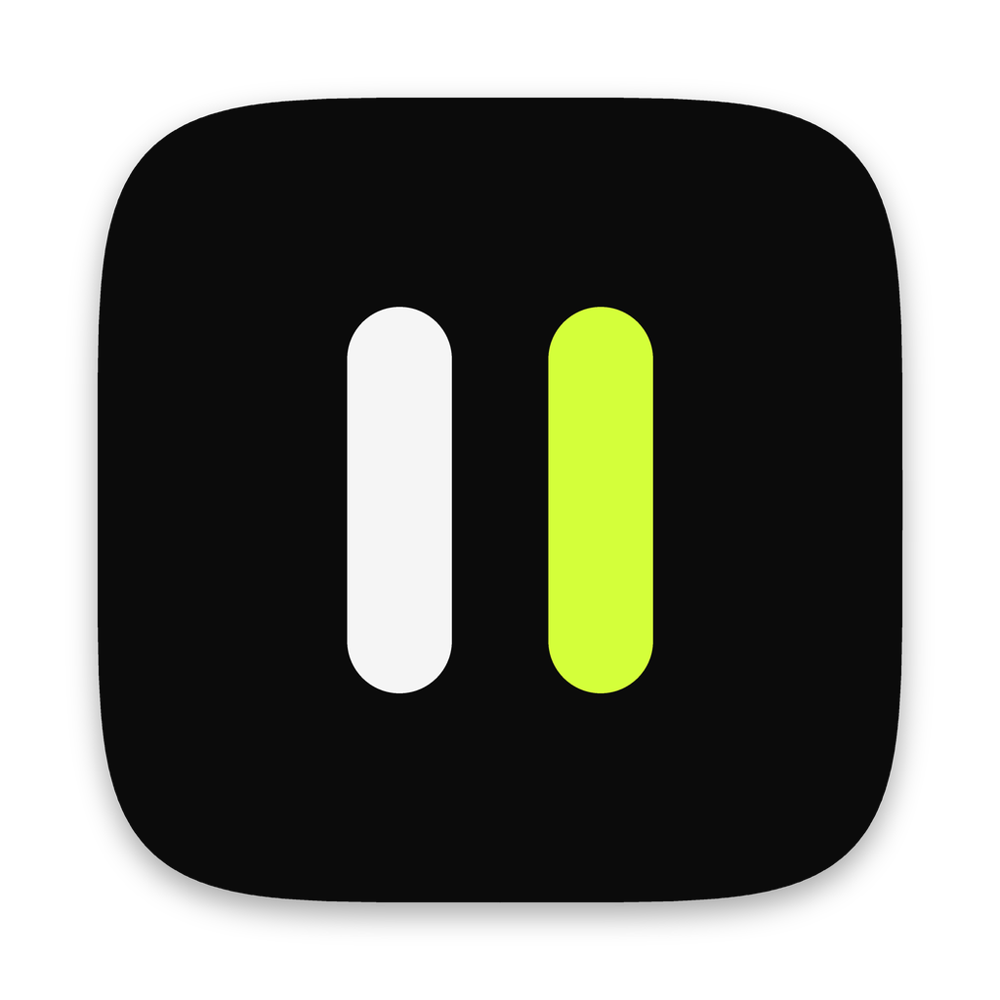
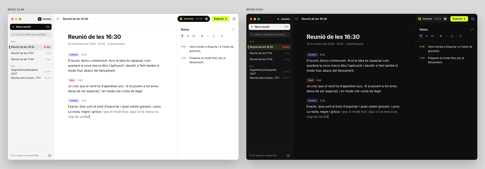

<p align="center">
  
</p>

<h1 align="center">Murmur</h1>

<p align="center">
  Transcripción de reuniones que nunca sale de tu ordenador.<br />
  En catalán, castellano e inglés, en directo y sabiendo quién habla.
</p>

<p align="center">
  <a href="https://github.com/quicodomingo/murmur-releases/releases/latest">Descargar para macOS, Windows y Linux</a> ·
  <a href="README.md">English</a> ·
  <a href="README.ca.md">Català</a>
</p>



Murmur es una app para macOS, Windows y Linux que transcribe tus reuniones mientras ocurren. Todo funciona en tu ordenador, y ningún audio va a ningún servidor. También distingue quién habla y te deja tomar notas y capturas de pantalla ligadas al momento en que las haces. Al terminar, puede escribir un resumen con el tono, las decisiones y las tareas. Lo puedes compartir con un enlace o guardarlo en Markdown en tu carpeta.

Nació para reuniones en **catalán**, donde la mayoría de servicios de transcripción fallan. Sobre todo cuando la gente pasa del catalán al castellano dentro de la misma frase.

## Qué hace

- **Transcripción en directo** en catalán, en castellano, en catalán y castellano mezclados o en inglés. Al empezar eliges el idioma y si hay más gente en la sala, y más adelante puedes volver a transcribir una reunión en otro idioma.
- **El micrófono y la llamada, por separado.** Murmur graba el micrófono y el audio del sistema (Zoom, Meet, Teams…) en dos canales y elimina el eco. Por eso funciona también con altavoces, no solo con auriculares. Nunca graba la pantalla: solo hace una captura cuando tú la pides. El audio del sistema funciona en macOS y en Windows; en Linux, de momento, Murmur graba solo el micrófono.
- **Hablantes.** Las voces se agrupan en directo. Al terminar, una segunda pasada por toda la grabación comprueba quién ha dicho cada cosa. Puedes cambiar «Hablante 1» por el nombre real o elegirlo entre los invitados del evento del calendario, y si una misma persona sale como dos hablantes, los juntas con un clic.
- **Pasada final con Whisper.** Cuando la reunión es en una sola lengua, Whisper large-v3-turbo la vuelve a escuchar cuando detienes la grabación. Reescribe el texto con puntuación, mayúsculas y nombres propios. No toca las frases que hayas corregido a mano.
- **Puntuación de Softcatalà.** Cuando la reunión mezcla catalán y castellano, o no tienes Whisper, el modelo de puntuación de Softcatalà le pone puntos, comas y mayúsculas al terminar. Es opcional (126 MB) y se descarga desde Configuración › Transcripción.
- **Continuar una reunión.** Si detienes demasiado pronto o hacéis una pausa, «Continuar» vuelve a grabar dentro de la misma reunión. La pausa queda marcada en la transcripción, las voces de la primera parte vuelven con su nombre y el resumen se hace con toda la reunión.
- **Glosario.** Añade los nombres, marcas y siglas que la transcripción escribe mal (WordPress, Softcatalà, el nombre de un cliente) y Murmur los escribirá bien, en directo y al terminar. Cuando corriges un nombre a mano, te propone añadirlo. En una reunión del calendario también cuentan los nombres de los invitados, y el resumen los escribe igual.
- **Barra flotante mientras grabas.** Una píldora pequeña en el borde de la pantalla se queda delante de la llamada. Muestra el nivel del audio, vuelve a abrir Murmur, detiene la grabación y hace capturas de la pantalla compartida. Cada captura queda ligada al momento de la conversación: aparece junto a lo que se estaba diciendo y dentro de la parte correspondiente del resumen. Si haces clic en la píldora, Murmur se convierte en una ventana estrecha de notas al lado de la llamada.
- **Transcribir desde un archivo.** Archivo › Transcribir desde un archivo… (⌘O, o Ctrl+O en Windows y Linux) convierte un mp3, m4a, wav, ogg o cualquier otro audio en una reunión, con los hablantes y la pasada final. Murmur adivina solo en qué idioma está. También puedes enviarle un audio desde el menú Compartir de otras apps, con «Abrir con» (en el Finder, el Explorador o tu gestor de archivos) o soltándolo sobre la ventana o el icono del Dock.
- **Conector para Claude**, opcional. Claude Desktop y Claude Code pueden leer y buscar tus reuniones y transcribir audios con Murmur, en tu ordenador. Se activa en Configuración › Claude.
- **Notas** con títulos, listas, casillas y sangrías con Tab. Cada bloque recuerda el minuto en que se escribió y aparece junto a la transcripción. Con ⌘+ y ⌘− (Ctrl+ y Ctrl− en Windows y Linux) haces más grande o más pequeño el texto de las notas.
- **Resumen de la reunión**, opcional. Tiene título, resumen, tono, decisiones y tareas, y lo escribe un modelo de lenguaje local (Gemma 4 E4B). Las tareas se pueden marcar, editar y asignar. Si lo prefieres, lo puede escribir Claude u OpenAI con tu clave: solo se envía el texto, nunca el audio.
- **Etiquetas** para ordenar las reuniones. Puedes filtrarlas en la barra lateral y buscarlas, y con el clic derecho las renombras, las juntas o las borras.
- **Calendario.** Murmur te avisa dos minutos antes de que empiece una reunión, y la grabación toma el título y los invitados del evento. Funciona con cualquier calendario añadido a macOS: iCloud, Google o Exchange. De momento, solo en macOS.
- **Compartir con un enlace.** Eliges qué aparece (resumen, notas, transcripción, capturas, audio), cuándo caduca el enlace y si lleva contraseña. Murmur lo cifra en el ordenador y lo publica en tu cuenta de Cloudflare, que es gratuita y se configura desde la app.
- **Markdown en tu carpeta.** Elige una carpeta y Murmur guarda en ella cada reunión cuando termina: todo (el resumen con las notas y la transcripción, en dos archivos), solo el resumen y las notas o solo la transcripción. Mientras grabas, puedes activarlo o desactivarlo para esa reunión.
- **Búsqueda** en todas las reuniones, y exportación a Markdown, Word, PDF, audio (.m4a en macOS, .ogg en Windows y Linux) y capturas. En Word y Markdown eliges si va todo, el resumen o la transcripción.
- **Interfaz** en catalán, castellano e inglés, con tres temas de color y modo claro y oscuro.
- **macOS, Windows y Linux.** La misma app en los tres sistemas, y se actualiza sola en todos. De momento hay cosas que solo están en el Mac: el calendario, las capturas de pantalla, el aviso cuando empieza una llamada y el menú Compartir.

## Privacidad

- Todo se hace en el ordenador: el reconocimiento de voz, los hablantes, Whisper y el modelo del resumen. Escribir el resumen con Claude u OpenAI es opcional, usa tu clave (guardada en el llavero del sistema: el de macOS, el Administrador de credenciales de Windows o el Secret Service de Linux) y solo envía texto.
- Murmur solo se conecta a internet para descargar modelos (la primera vez, y cuando activas una función opcional) y para buscar actualizaciones. Esta comprobación se puede desactivar. Las reuniones compartidas se cifran en el ordenador antes de salir de él, y solo puede leerlas quien tiene el enlace. Con el conector para Claude activado, Claude recibe el texto que pide, nunca el audio.
- Las reuniones se guardan en una base de datos SQLite local. El audio solo se guarda si lo activas.
- Para grabar una reunión hace falta el consentimiento de todas las personas que participan. Murmur te lo recuerda al empezar.

## Requisitos

- **macOS:** un Mac con Apple Silicon (M1 o posterior) y macOS 14.2 o posterior.
- **Windows:** Windows 10 u 11 de 64 bits (x86-64), con un procesador con AVX2 (Intel desde 2013, AMD desde 2015). WebView2 ya viene con Windows, y si no está el instalador lo añade.
- **Linux:** una distribución de 64 bits (x86-64) con WebKitGTK 4.1, como Ubuntu 22.04 o posterior, Debian 12 o Fedora 38 o posterior, con un procesador con AVX2. Para guardar las claves, un Secret Service (GNOME Keyring o KWallet).
- 8 GB de memoria. Para el resumen local se recomiendan 16. En Windows y Linux todo va por el procesador, y la pasada final y el resumen son más lentos que en un Mac.
- Unos 600 MB de disco para los modelos básicos. Los opcionales ocupan más: inglés, 458 MB; Whisper, 574 MB; Gemma, 5,2 GB.

## Instalación

Todo está en [Releases](https://github.com/quicodomingo/murmur-releases/releases/latest). La primera vez que la abres, Murmur descarga los modelos de voz (unos 600 MB). Se actualiza sola en los tres sistemas.

**macOS.** Descarga el `.dmg` y arrastra Murmur a Aplicaciones. La app está firmada y notarizada por Apple. Te pide estos permisos:

- **Micrófono.**
- **Grabación de audio del sistema**, para oír el otro lado de la llamada.
- **Calendario**, opcional.
- **Grabación de pantalla**, solo si quieres hacer capturas de una pantalla compartida.


**Windows.** Descarga `Murmur_<versión>_x64-setup.exe` y ejecútalo. Se instala solo para tu usuario, sin permisos de administrador. El instalador aún no está firmado con un certificado de Windows, y es posible que SmartScreen te avise la primera vez: haz clic en *Más información › Ejecutar de todas formas*. Si Windows no deja que Murmur use el micrófono, actívalo en Configuración › Privacidad y seguridad › Micrófono.

**Linux.** Elige el paquete de tu distribución:

```bash
# Debian, Ubuntu y derivadas
sudo apt install ./Murmur_<versión>_amd64.deb

# Fedora, openSUSE y derivadas
sudo dnf install ./Murmur-<versión>-1.x86_64.rpm

# Cualquier distribución: la AppImage, que también se actualiza sola
chmod +x Murmur_<versión>_amd64.AppImage && ./Murmur_<versión>_amd64.AppImage
```

Los paquetes `.deb` y `.rpm` no se actualizan solos: instala la versión nueva de la misma forma. La AppImage, sí.

## Modelos

| Qué | Modelo | De | Licencia |
|---|---|---|---|
| Catalán y castellano, en directo | Conformer-Transducer ca-es | Projecte AINA (BSC), a partir de NVIDIA | CC BY 4.0 |
| Inglés, en directo | Parakeet TDT-CTC 110M | NVIDIA | CC BY 4.0 |
| Pasada final | Whisper large-v3-turbo (whisper.cpp) | OpenAI | MIT |
| Puntuación en catalán | fullstop-catalan-punctuation-prediction | Softcatalà | MIT |
| Detección de voz | Silero VAD | Silero | MIT |
| Hablantes, en directo | TitaNet small | NVIDIA NeMo | Apache 2.0 |
| Hablantes, pasada final | pyannote segmentation 3.0 + ERes2Net | pyannote, 3D-Speaker | MIT, Apache 2.0 |
| Resumen | Gemma 4 E4B | Google | Apache 2.0 |

La voz y los hablantes funcionan con [sherpa-onnx](https://github.com/k2-fsa/sherpa-onnx). Whisper funciona con [whisper.cpp](https://github.com/ggml-org/whisper.cpp), y Gemma con [llama.cpp](https://github.com/ggml-org/llama.cpp). Los dos usan Metal en el Mac, y el procesador (AVX2) en Windows y Linux.

## Compilarla

Necesitas [Rust](https://rustup.rs), Node.js 20 o posterior y CMake, y en cada sistema:

- **macOS:** las Command Line Tools de Xcode y CMake (`brew install cmake`).
- **Windows:** las [Build Tools de Visual Studio](https://visualstudio.microsoft.com/visual-cpp-build-tools/) con *Desarrollo para el escritorio con C++*, [CMake](https://cmake.org/download/) y [LLVM](https://github.com/llvm/llvm-project/releases) (para `libclang`).
- **Linux** (Debian o Ubuntu):
  ```bash
  sudo apt install build-essential cmake clang libwebkit2gtk-4.1-dev libayatana-appindicator3-dev \
    librsvg2-dev patchelf libasound2-dev libdbus-1-dev libssl-dev
  ```

Después, en cualquiera de ellos:

```bash
git clone https://github.com/quicodomingo/murmur.git
cd murmur/app
npm install
npm run tauri dev
```

`tauri dev` también compila `murmur-whisper`, el proceso aparte que ejecuta Whisper. Los modelos se descargan la primera vez que abres la app, en `models/`, en la raíz del repositorio.

Otros comandos útiles:

```bash
# La app con un WAV (16 kHz) en lugar del micrófono, a ritmo real
TRANSCRIPTOR_SIMULATE=../data/reunion.wav npm run tauri dev

# El motor en directo sin interfaz
cd src-tauri && cargo run --release --example simulate -- ../../data/reunion.wav

# Tests y comprobaciones
cd src-tauri && cargo test
cd app && npx tsc --noEmit && npm run check-locales

# Pruebas e2e de la app compilada (ver app/e2e/wdio.conf.mjs)
cd app && npm run tauri build -- --debug --no-bundle
cd e2e && npm ci && npm run motor        # el motor transcribe un archivo de verdad (cualquier sistema)
npm run interficie && npm run importa    # la interfaz, con tauri-driver (Windows y Linux)
```

`npm run tauri build` hace los instaladores del sistema en el que estás: una `.app` en macOS, un instalador `.exe` en Windows, y `.deb`, `.rpm` y AppImage en Linux. GitHub Actions compila y prueba cada cambio en los tres sistemas ([`.github/workflows/ci.yml`](.github/workflows/ci.yml)), y al subir una etiqueta `v<versión>` publica la versión ([`release.yml`](.github/workflows/release.yml)). La versión para Mac está firmada y notarizada, y hace falta un Developer ID de Apple. Lo explica [docs/PUBLICAR.md](docs/PUBLICAR.md) (en catalán).

## Estructura del repositorio

| Carpeta | Qué hay |
|---|---|
| `app/` | La app: interfaz en React (`src/`), motor en Rust (`src-tauri/`) y proceso de Whisper (`whisper/`) |
| `bench/` | Banco de pruebas en Python para elegir los modelos (WER, factor de tiempo real, aciertos de hablantes) |
| `mvp/` | El primer prototipo, en Python con interfaz web. Se mantiene como referencia |
| `tools/` | Scripts para exportar los modelos de NeMo a ONNX |
| `docs/` | Hoja de ruta, sistema de diseño, traducciones y guía para publicar (en catalán) |

[docs/ARQUITECTURA.md](docs/ARQUITECTURA.md) explica cómo funciona por dentro y qué se ha medido para decidirlo, y [CLAUDE.md](CLAUDE.md) tiene las reglas para trabajar en el código (para personas y agentes de código). Los dos están en catalán.

## Traducciones

La interfaz está en catalán, castellano e inglés. Los textos están en `app/src/locales/<idioma>/`. Para corregir una traducción o añadir un idioma, consulta [docs/TRADUCCIONS.md](docs/TRADUCCIONS.md).

## Hoja de ruta

Los próximos pasos son el calendario y las capturas en Windows y Linux, el audio del sistema en Linux y mejorar la detección de hablantes. La lista completa está en [docs/ROADMAP.md](docs/ROADMAP.md).

## Colaborar

Los *issues* y las *pull requests* son bienvenidos. Nos son especialmente útiles las grabaciones de reuniones reales con una transcripción hecha a mano, porque sirven para medir la precisión. Compártelas solo si todas las personas que aparecen están de acuerdo.

## Licencia

[MIT](LICENSE). Los modelos mantienen sus propias licencias (ver [Modelos](#modelos)).
