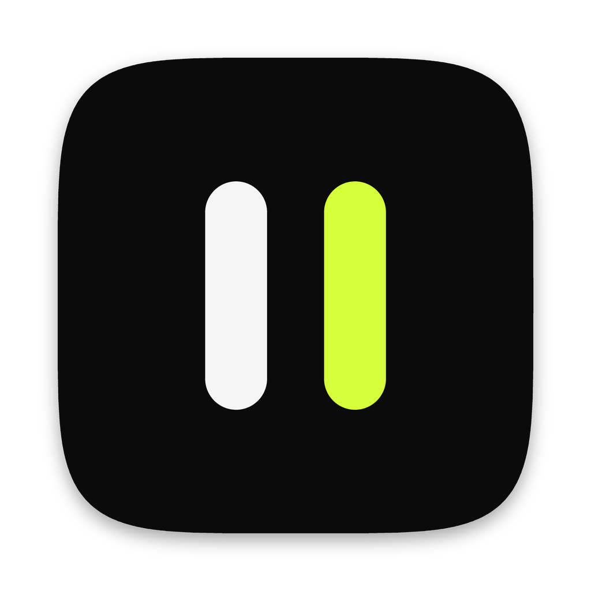
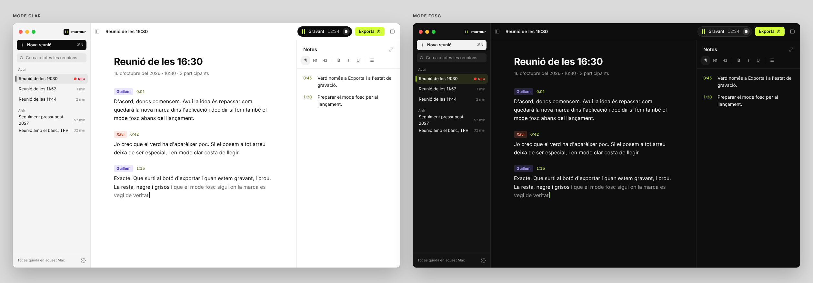

<p align="center">
  
</p>

<h1 align="center">Murmur</h1>

<p align="center">
  Meeting transcription that never leaves your computer.<br />
  Catalan, Spanish and English, live, with speaker identification.
</p>

<p align="center">
  <a href="https://github.com/quicodomingo/murmur-releases/releases/latest">Download for macOS, Windows and Linux</a> ·
  <a href="README.ca.md">Català</a> ·
  <a href="README.es.md">Español</a>
</p>



Murmur is an app for macOS, Windows and Linux that transcribes your meetings as they happen. It runs fully on your computer, so no audio goes to a server. It also tells speakers apart, lets you take notes and screenshots tied to the moment they were written, and when the meeting ends it can write a summary with tone, decisions and tasks. You can share it with a link or keep it as Markdown in your own folder.

It started as a tool for meetings in **Catalan**, where most transcription services struggle, especially when people switch between Catalan and Spanish in the same sentence.

## Features

- **Live transcription** in Catalan, Spanish, Catalan + Spanish mixed, or English. You pick the language and whether there are more people in the room when you start, and you can transcribe a meeting again in another language later.
- **Your mic and the call, separately.** Murmur records your microphone and the system audio (Zoom, Meet, Teams…) as two channels and removes the echo, so it works with speakers too, not just headphones. It never records the screen: it only takes a screenshot when you ask for one. System audio works on macOS and Windows; on Linux Murmur records the microphone for now.
- **Speakers.** Voices are grouped live. When the meeting ends, a second pass over the whole recording checks who said what. Rename “Speaker 1” to a real name, or pick one from the calendar event's guests, and if one person shows up as two speakers, merge them in one click.
- **Final pass with Whisper.** For single-language meetings, Whisper large-v3-turbo listens again after you stop and rewrites the text with punctuation, capitals and proper names. It doesn't touch the lines you corrected by hand.
- **Softcatalà's punctuation.** When the meeting mixes Catalan and Spanish, or you don't have Whisper, Softcatalà's punctuation model adds full stops, commas and capitals when it finishes. It's optional (126 MB) and downloads from Settings › Transcription.
- **Continue a meeting.** If you stop too early or take a break, "Continue" records again within the same meeting. The break is marked in the transcript, the voices from the first part come back with their names, and the summary covers the whole meeting.
- **Glossary.** Add the names, brands and acronyms the transcription gets wrong (WordPress, Softcatalà, a client's name) and Murmur will spell them right, live and when it finishes. When you correct a name by hand, it offers to add it. In a calendar meeting the guests' names count too, and the summary spells them the same way.
- **Floating bar while you record.** A small pill on the edge of the screen stays on top of your call: it shows the audio level, brings Murmur back, stops the recording and takes a screenshot of the shared screen. Each screenshot is tied to the moment of the conversation, so it appears next to what was being said, and in the right part of the summary. Click the pill to turn Murmur into a narrow notes window beside the call.
- **Transcribe from a file.** File › Transcribe from File… (⌘O, Ctrl+O on Windows and Linux) turns an mp3, m4a, wav, ogg or other audio file into a meeting, with speakers and the final pass. Murmur works out the language by itself. You can also send it an audio file from other apps' Share menu, with Open With (Finder, Explorer or your file manager), or by dropping it on the window or the Dock icon.
- **Claude connector**, optional. Claude Desktop and Claude Code can read and search your meetings and transcribe audio files with Murmur, on your computer. Turn it on in Settings › Claude.
- **Notes** with headings, lists, checkboxes and Tab indents. Each block remembers the minute it was written and shows up next to the transcript. ⌘+ and ⌘− (Ctrl+ and Ctrl− on Windows and Linux) make the notes text bigger or smaller.
- **Meeting summary**, optional: a title, summary, tone, decisions and tasks, written by a local language model (Gemma 4 E4B). Tasks can be checked off, edited and assigned. If you prefer, it can be written by Claude or OpenAI with your own key: only the text is sent, never the audio.
- **Tags** to organise meetings. Filter by them in the sidebar, search them, and rename, merge or delete them with a right click.
- **Calendar.** Murmur reminds you two minutes before a meeting starts, and the recording takes the event's title and guests. It works with any calendar added to macOS: iCloud, Google, Exchange. Only on macOS for now.
- **Share with a link.** Choose what goes in (summary, notes, transcript, screenshots, audio), when the link expires and whether it has a password. Murmur encrypts it on your computer and publishes it to your own Cloudflare account, which is free and is set up from the app.
- **Markdown in your folder.** Pick a folder and Murmur saves each meeting there when it ends: everything (the summary with the notes and the transcript, as two files), just the summary and notes, or just the transcript. You can turn it on or off for each meeting while recording.
- **Search** across all your meetings, plus export to Markdown, Word, PDF, audio (.m4a on macOS, .ogg on Windows and Linux) and screenshots. For Word and Markdown you choose everything, the summary or the transcript.
- **Interface** in Catalan, Spanish and English, with three colour themes and light and dark modes.
- **macOS, Windows and Linux.** The same app on all three, and it updates itself on each. Some things are only on the Mac for now: the calendar, screenshots, noticing a call has started and the Share menu.

## Privacy

- Everything runs on your computer: speech recognition, speakers, Whisper and the summary model. Writing the summary with Claude or OpenAI is optional, uses your own key (kept in the system's keychain: the macOS Keychain, Windows Credential Manager or the Secret Service on Linux) and only sends text.
- Murmur only connects to the internet to download models (the first time, and when you enable an optional feature) and to check for updates. You can turn the update check off. Shared meetings are encrypted on your computer before leaving it, and only you and whoever has the link can read them. With the Claude connector on, Claude gets the text it asks for, never the audio.
- Meetings are stored in a local SQLite database. Audio is only saved if you turn it on.
- Recording a meeting requires the consent of everyone in it. Murmur reminds you when you start.

## Requirements

- **macOS:** a Mac with Apple Silicon (M1 or later) and macOS 14.2 or later.
- **Windows:** Windows 10 or 11, 64-bit (x86-64), with a processor with AVX2 (Intel since 2013, AMD since 2015). WebView2 comes with Windows; the installer adds it if it's missing.
- **Linux:** a 64-bit (x86-64) distribution with WebKitGTK 4.1, such as Ubuntu 22.04 or later, Debian 12, Fedora 38 or later, with a processor with AVX2. For the keys to be saved, a Secret Service (GNOME Keyring or KWallet).
- 8 GB of memory. 16 GB is recommended for the local summary. On Windows and Linux everything runs on the processor, so the final pass and the summary are slower than on a Mac.
- About 600 MB of disk for the base models. Optional models take more: English 458 MB, Whisper 574 MB, Gemma 5.2 GB.

## Install

Everything is in [Releases](https://github.com/quicodomingo/murmur-releases/releases/latest). The first time you open it, Murmur downloads the speech models (about 600 MB). It updates itself on all three systems.

**macOS.** Download the `.dmg` and drag Murmur to Applications. The app is signed and notarized by Apple. It asks for these permissions:

- **Microphone.**
- **System audio recording**, to hear the other side of a call.
- **Calendar**, optional.
- **Screen recording**, only if you want to take screenshots of a shared screen.

**Windows.** Download `Murmur_<version>_x64-setup.exe` and run it. It installs for your user only, with no administrator rights. The installer isn't signed with a Windows certificate yet, so SmartScreen may warn you the first time: click *More info › Run anyway*. If Windows doesn't let Murmur use the microphone, turn it on in Settings › Privacy & security › Microphone.

**Linux.** Choose the package for your distribution:

```bash
# Debian, Ubuntu and derivatives
sudo apt install ./Murmur_<version>_amd64.deb

# Fedora, openSUSE and derivatives
sudo dnf install ./Murmur-<version>-1.x86_64.rpm

# Any distribution: the AppImage, which also updates itself
chmod +x Murmur_<version>_amd64.AppImage && ./Murmur_<version>_amd64.AppImage
```

The `.deb` and `.rpm` packages don't update themselves: install the new version the same way. The AppImage does.

## Models

| What | Model | By | Licence |
|---|---|---|---|
| Catalan and Spanish, live | Conformer-Transducer ca-es | Projecte AINA (BSC), from NVIDIA | CC BY 4.0 |
| English, live | Parakeet TDT-CTC 110M | NVIDIA | CC BY 4.0 |
| Final pass | Whisper large-v3-turbo (whisper.cpp) | OpenAI | MIT |
| Catalan punctuation | fullstop-catalan-punctuation-prediction | Softcatalà | MIT |
| Voice activity | Silero VAD | Silero | MIT |
| Speakers, live | TitaNet small | NVIDIA NeMo | Apache 2.0 |
| Speakers, final pass | pyannote segmentation 3.0 + ERes2Net | pyannote, 3D-Speaker | MIT, Apache 2.0 |
| Summary | Gemma 4 E4B | Google | Apache 2.0 |

Speech recognition and speakers run on [sherpa-onnx](https://github.com/k2-fsa/sherpa-onnx). Whisper runs on [whisper.cpp](https://github.com/ggml-org/whisper.cpp) and Gemma on [llama.cpp](https://github.com/ggml-org/llama.cpp), both with Metal on the Mac and on the processor (AVX2) on Windows and Linux.

## Build from source

You need [Rust](https://rustup.rs), Node.js 20+ and CMake, and on each system:

- **macOS:** Xcode Command Line Tools and CMake (`brew install cmake`).
- **Windows:** [Visual Studio Build Tools](https://visualstudio.microsoft.com/visual-cpp-build-tools/) with *Desktop development with C++*, [CMake](https://cmake.org/download/) and [LLVM](https://github.com/llvm/llvm-project/releases) (for `libclang`).
- **Linux** (Debian or Ubuntu):
  ```bash
  sudo apt install build-essential cmake clang libwebkit2gtk-4.1-dev libayatana-appindicator3-dev \
    librsvg2-dev patchelf libasound2-dev libdbus-1-dev libssl-dev
  ```

Then, on any of them:

```bash
git clone https://github.com/quicodomingo/murmur.git
cd murmur/app
npm install
npm run tauri dev
```

`tauri dev` also builds `murmur-whisper`, the separate process that runs Whisper. Models download on first launch into `models/` at the repository root.

Other useful commands:

```bash
# Run the app on a WAV file (16 kHz) instead of the microphone, at real-time speed
TRANSCRIPTOR_SIMULATE=../data/meeting.wav npm run tauri dev

# The live engine without UI
cd src-tauri && cargo run --release --example simulate -- ../../data/meeting.wav

# Tests and checks
cd src-tauri && cargo test
cd app && npx tsc --noEmit && npm run check-locales

# End-to-end tests of the built app (see app/e2e/wdio.conf.mjs)
cd app && npm run tauri build -- --debug --no-bundle
cd e2e && npm ci && npm run motor        # the engine transcribes a real file (any system)
npm run interficie && npm run importa    # the interface, with tauri-driver (Windows and Linux)
```

`npm run tauri build` makes the installers for the system you're on: a `.app` on macOS, an `.exe` installer on Windows, and `.deb`, `.rpm` and AppImage on Linux. Every change is built and tested on all three by GitHub Actions ([`.github/workflows/ci.yml`](.github/workflows/ci.yml)), and pushing a `v<version>` tag publishes the release ([`release.yml`](.github/workflows/release.yml)). The Mac release is signed and notarized and needs an Apple Developer ID; see [docs/PUBLICAR.md](docs/PUBLICAR.md).

## Repository layout

| Folder | What's inside |
|---|---|
| `app/` | The app: React interface (`src/`), Rust engine (`src-tauri/`), Whisper process (`whisper/`) |
| `bench/` | Python benchmark used to choose models (WER, real-time factor, speaker accuracy) |
| `mvp/` | The first prototype, in Python with a web interface. Kept as a reference |
| `tools/` | Scripts to export the NeMo models to ONNX |
| `docs/` | Roadmap, design system, translations and release guide (in Catalan) |

[docs/ARQUITECTURA.md](docs/ARQUITECTURA.md) explains how it works inside and what was measured to decide it, and [CLAUDE.md](CLAUDE.md) has the rules for working on the code (for people and coding agents). Both are in Catalan.

## Translations

The interface is available in Catalan, Spanish and English. Strings are in `app/src/locales/<language>/`. To fix a translation or add a language, see [docs/TRADUCCIONS.md](docs/TRADUCCIONS.md).

## Roadmap

Next: the calendar and screenshots on Windows and Linux, system audio on Linux, and better speaker detection. The full list is in [docs/ROADMAP.md](docs/ROADMAP.md).

## Contributing

Issues and pull requests are welcome. Recordings of real meetings with a hand-made transcript are especially useful for measuring accuracy, but please only share them if everyone in the meeting agrees.

## Licence

[MIT](LICENSE). The models keep their own licences (see [Models](#models)).
