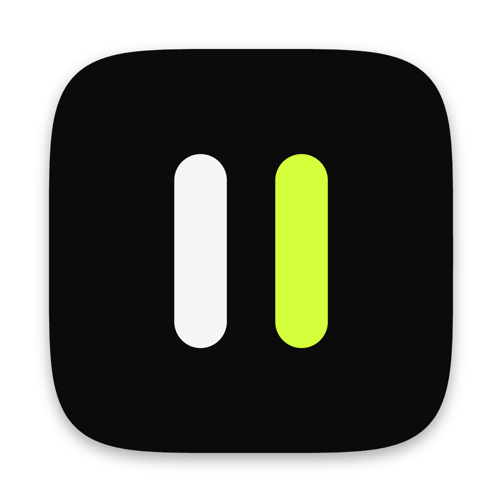
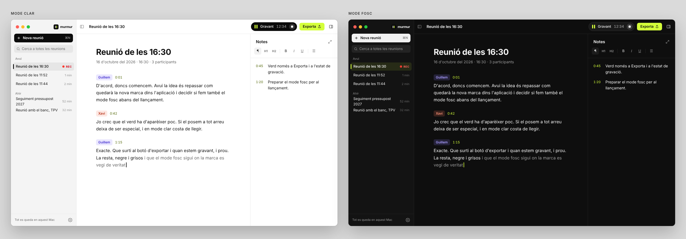

<p align="center">
  
</p>

<h1 align="center">Murmur</h1>

<p align="center">
  Meeting transcription that never leaves your Mac.<br />
  Catalan, Spanish and English, live, with speaker identification.
</p>

<p align="center">
  <a href="https://github.com/quicodomingo/murmur-releases/releases/latest">Download for macOS</a> ·
  <a href="README.ca.md">Català</a> ·
  <a href="README.es.md">Español</a>
</p>



Murmur is a Mac app that transcribes your meetings as they happen. It runs fully on your computer, so no audio goes to a server. It also tells speakers apart, lets you take notes and screenshots tied to the moment they were written, and when the meeting ends it can write a summary with tone, decisions and tasks. You can share it with a link or keep it as Markdown in your own folder.

It started as a tool for meetings in **Catalan**, where most transcription services struggle, especially when people switch between Catalan and Spanish in the same sentence.

## Features

- **Live transcription** in Catalan, Spanish, Catalan + Spanish mixed, or English. You pick the language and whether there are more people in the room when you start, and you can transcribe a meeting again in another language later.
- **Your mic and the call, separately.** Murmur records your microphone and the system audio (Zoom, Meet, Teams…) as two channels and removes the echo, so it works with speakers too, not just headphones. It never records the screen: it only takes a screenshot when you ask for one.
- **Speakers.** Voices are grouped live. When the meeting ends, a second pass over the whole recording checks who said what. Rename “Speaker 1” to a real name, or pick one from the calendar event's guests.
- **Final pass with Whisper.** For single-language meetings, Whisper large-v3-turbo listens again after you stop and rewrites the text with punctuation, capitals and proper names. It doesn't touch the lines you corrected by hand.
- **Floating bar while you record.** A small pill on the edge of the screen stays on top of your call: it shows the audio level, brings Murmur back, stops the recording and takes a screenshot of the shared screen. Each screenshot is tied to the moment of the conversation, so it appears next to what was being said, and in the right part of the summary. Click the pill to turn Murmur into a narrow notes window beside the call.
- **Notes** with headings, lists and checkboxes. Each block remembers the minute it was written and shows up next to the transcript. ⌘+ and ⌘− make the notes text bigger or smaller.
- **Meeting summary**, optional: a title, summary, tone, decisions and tasks, written by a local language model (Gemma 4 E4B). Tasks can be checked off, edited and assigned. If you prefer, it can be written by Claude or OpenAI with your own key: only the text is sent, never the audio.
- **Tags** to organise meetings. Filter by them in the sidebar, search them, and rename, merge or delete them with a right click.
- **Calendar.** Murmur reminds you two minutes before a meeting starts, and the recording takes the event's title and guests. It works with any calendar added to macOS: iCloud, Google, Exchange.
- **Share with a link.** Choose what goes in (summary, notes, transcript, screenshots, audio), when the link expires and whether it has a password. Murmur encrypts it on your Mac and publishes it to your own Cloudflare account, which is free and is set up from the app.
- **Markdown in your folder.** Pick a folder and Murmur saves the summary, notes and transcript of each meeting there when it ends. You can turn it on or off for each meeting while recording.
- **Search** across all your meetings, plus export to Markdown, Word, PDF, audio (.m4a) and screenshots.
- **Interface** in Catalan, Spanish and English, with three colour themes and light and dark modes.

## Privacy

- Everything runs on your Mac: speech recognition, speakers, Whisper and the summary model. Writing the summary with Claude or OpenAI is optional, uses your own key (kept in the macOS keychain) and only sends text.
- Murmur only connects to the internet to download models (the first time, and when you enable an optional feature) and to check for updates. You can turn the update check off. Shared meetings are encrypted on your Mac before leaving it, and only you and whoever has the link can read them.
- Meetings are stored in a local SQLite database. Audio is only saved if you turn it on.
- Recording a meeting requires the consent of everyone in it. Murmur reminds you when you start.

## Requirements

- A Mac with Apple Silicon (M1 or later) and **macOS 14.2** or later.
- 8 GB of memory. 16 GB is recommended for the local summary.
- About 600 MB of disk for the base models. Optional models take more: English 458 MB, Whisper 574 MB, Gemma 5.2 GB.

## Install

Download the latest `.dmg` from [Releases](https://github.com/quicodomingo/murmur-releases/releases/latest) and drag Murmur to Applications. The app is signed and notarized by Apple, and it updates itself.

The first time you open it, Murmur downloads the speech models and asks for these permissions:

- **Microphone.**
- **System audio recording**, to hear the other side of a call.
- **Calendar**, optional.
- **Screen recording**, only if you want to take screenshots of a shared screen.

## Models

| What | Model | By | Licence |
|---|---|---|---|
| Catalan and Spanish, live | Conformer-Transducer ca-es | Projecte AINA (BSC), from NVIDIA | CC BY 4.0 |
| English, live | Parakeet TDT-CTC 110M | NVIDIA | CC BY 4.0 |
| Final pass | Whisper large-v3-turbo (whisper.cpp) | OpenAI | MIT |
| Voice activity | Silero VAD | Silero | MIT |
| Speakers, live | TitaNet small | NVIDIA NeMo | Apache 2.0 |
| Speakers, final pass | pyannote segmentation 3.0 + ERes2Net | pyannote, 3D-Speaker | MIT, Apache 2.0 |
| Summary | Gemma 4 E4B | Google | Apache 2.0 |

Speech recognition and speakers run on [sherpa-onnx](https://github.com/k2-fsa/sherpa-onnx). Whisper runs on [whisper.cpp](https://github.com/ggml-org/whisper.cpp) and Gemma on [llama.cpp](https://github.com/ggml-org/llama.cpp), both with Metal.

## Build from source

You need [Rust](https://rustup.rs), Node.js 20+, Xcode Command Line Tools and CMake (`brew install cmake`).

```bash
git clone https://github.com/quicodomingo/murmur.git
cd murmur/app
npm install
npm run tauri dev
```

`tauri dev` also builds `murmur-whisper`, the separate process that runs Whisper. Models download on first launch into `models/` at the repository root.

Other useful commands:

```bash
# Run the app on a WAV file (16 kHz) instead of the microphone, at real-time speed
TRANSCRIPTOR_SIMULATE=../data/meeting.wav npm run tauri dev

# The live engine without UI
cd src-tauri && cargo run --release --example simulate -- ../../data/meeting.wav

# Tests and checks
cd src-tauri && cargo test
cd app && npx tsc --noEmit && npm run check-locales
```

`app/scripts/release.sh` builds a signed and notarized release. It needs an Apple Developer ID; see [docs/PUBLICAR.md](docs/PUBLICAR.md).

## Repository layout

| Folder | What's inside |
|---|---|
| `app/` | The app: React interface (`src/`), Rust engine (`src-tauri/`), Whisper process (`whisper/`) |
| `bench/` | Python benchmark used to choose models (WER, real-time factor, speaker accuracy) |
| `mvp/` | The first prototype, in Python with a web interface. Kept as a reference |
| `tools/` | Scripts to export the NeMo models to ONNX |
| `docs/` | Roadmap, design system, translations and release guide (in Catalan) |

[docs/ARQUITECTURA.md](docs/ARQUITECTURA.md) explains how it works inside and what was measured to decide it, and [CLAUDE.md](CLAUDE.md) has the rules for working on the code (for people and coding agents). Both are in Catalan.

## Translations

The interface is available in Catalan, Spanish and English. Strings are in `app/src/locales/<language>/`. To fix a translation or add a language, see [docs/TRADUCCIONS.md](docs/TRADUCCIONS.md).

## Roadmap

Windows support, a custom vocabulary for names and brands, and better speaker detection are next. The full list is in [docs/ROADMAP.md](docs/ROADMAP.md).

## Contributing

Issues and pull requests are welcome. Recordings of real meetings with a hand-made transcript are especially useful for measuring accuracy, but please only share them if everyone in the meeting agrees.

## Licence

To be decided.
